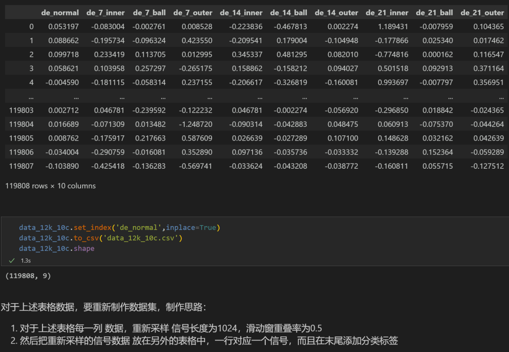
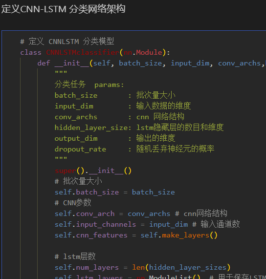
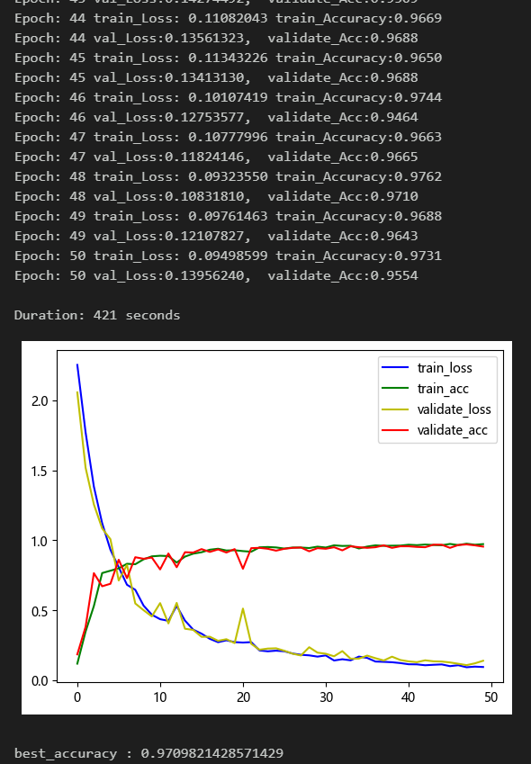
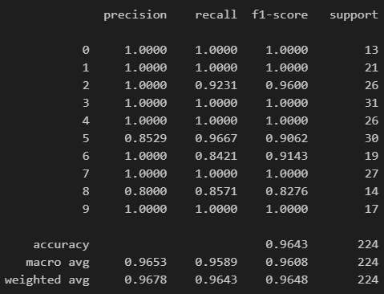
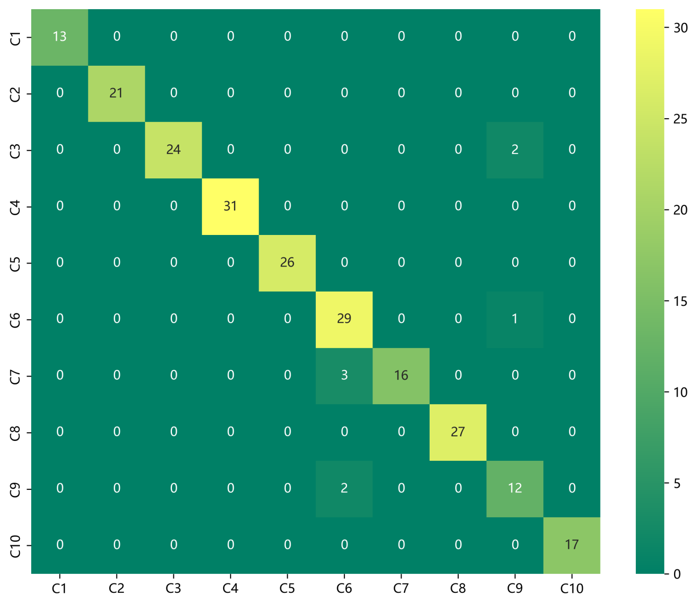
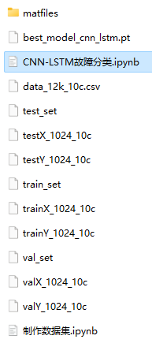

# Bearing Fault Diagnosis CNN-LSTM Fault Classification Model

Including the complete CWRU bearing fault dataset, as well as the fault signal dataset, classification data, and label set that have been generated and ready for use.
50 epochs, accuracy of 98%, the classification effect of CNN-LSTM network is remarkable. The model can fully extract spatial and temporal features as well as frequency domain features of bearing fault signals. It has a fast convergence speed and superior performance with high precision. Innovation also exists!!!
Includes code for data preprocessing and CNN-LSTM classification.
Environment: Python 3.9, PyTorch 1.8 and above.
Preface
This article is based on the bearing data from Case Western Reserve University (CWRU), which first undergoes data preprocessing to create and load the dataset, and finally implements a CNN-LSTM model for the classification of fault data through Pytorch. For a detailed introduction to the bearing data from CWRU, please refer to the following text:
Python-Case Western Reserve University (CWRU) Bearing Data Interpretation and Classification Process
1. Bearing Data Loading and Preprocessing
1.1 Import data
Refer to the previous article for preprocessing of fault classification 10, and the Case Western Reserve University bearing data set: Classification 10 dataset.
\ttrain_set, val_set, test_set are all divided into training set, validation set and test set according to the ratio of 7:2:1, and finally save data.
The above figure illustrates the data reading format and preprocessing approach.
1.2 Data preprocessing, dataset preparation
\t  
2. CNN-LSTM Diagnosis Model Based on Pytorch
2.1 Define the CNN-LSTM classification network model
2.2 Set parameters and train the model
\t50 epochs, nearly 98% accuracy, CNN-LSTM network classification effect is significant. The CNN-LSTM model can fully extract multi-scale features of bearing fault signals, converges quickly, and has particularly excellent performance, with obvious effects.
1. Adjustment of parameters:
- Increase the number of LSTM layers and the dimensionality per layer, fine-tuning learning rates;
- Tune the number of CNN layers and the number of neurons per layer, increase more epochs (note to prevent overfitting);
- Change the shape of one-dimensional signal stacking (set appropriate length and dimension);
2.3 Model evaluation:
- Accuracy, Precision, Recall, F1 Score
- Fault classification confusion matrix:
- Previously excellent content:
- Python-Case Western Reserve University (CWRU) bearing data interpretation and classification processing
- Python bearing fault diagnosis (I) Short-time Fourier Transform STFT
- Python bearing fault diagnosis (II) Continuous Wavelet Transform CWT
- Python bearing fault diagnosis (III) Empirical Mode Decomposition EMD
Pytorch-LSTM bearing fault one-dimensional signal classification (I)
Pytorch-CNN bearing fault one-dimensional signal classification (II)
Pytorch-Transformer bearing fault one-dimensional signal classification (III)
Python bearing fault diagnosis (IV) Based on EMD-CNN fault classification
Python bearing fault diagnosis (V) Based on EMD-LSTM fault classification
Python bearing fault diagnosis (VI) Based on EMD-Transformer fault classification
Python bearing fault diagnosis (VII) Based on EMD-CNN-LSTM fault classification
Python bearing fault diagnosis (VIII) Based on EMD-CNN-GRU parallel model fault classification
Based on FFT + CNN - BiGRU-Attention time domain, frequency domain feature attention fusion bearing fault recognition model
Based on FFT + CNN - Transformer time domain, frequency domain feature fusion bearing fault recognition model
Python Bearing Fault Diagnosis (IX) VM-D+CNN-BiLSTM for Fault Classification
Python Bearing Fault Diagnosis (X) VM-D+CNN-Transformer for Fault Classification
Python Bearing Fault Diagnosis (11) VM-D+CNN-BiGRU-Attenion for Fault Classification
Cross Attention Fusion of Time and Frequency Features with FFT + CNN-BiLSTM-CrossAttention Bearing Fault Identification Model
Cross Attention Fusion of Time and Frequency Features with FFT + CNN-Transformer-CrossAttention Bearing Fault Identification Model
Introduction to Python Bearing Fault Diagnosis
Python Bearing Fault Diagnosis (13) Super-strong Machine Learning Recognition Model Based on Fault Signal Feature Extraction
Python Bearing Fault Diagnosis (14) Highly Innovative Fault Recognition Model
Python Bearing Fault Diagnosis (15) One-Dimensional Fault Signal Recognition Model Based on CNN-Transformer
Python Bearing Fault Diagnosis (16) Highly Innovative Fault Recognition Model (II)
SCI 1 Region Highly Innovative Bearing Fault Diagnosis Model!
Python Bearing Fault Diagnosis (18) Innovation-based Diagnosis Model Based on CNN-TCN-Attention
Highly Innovative Bearing Fault Diagnosis Model Based on GADF+Swin-CNN-GAM
Attention Magic Modified | Super-strong Bearing Fault Diagnosis Model!
End
\t2. Friends who like this can click the follow button, give the article a "like", share it in WeChat groups or discuss in groups.

## Images

<!-- PAYMENT_BLOCK -->

## Get this dataset

- Payment link (Stripe): [Buy now](https://buy.stripe.com/3cs8yP7sY87d0vu9AB)
- Payment QR code: 

<!-- /PAYMENT_BLOCK -->
